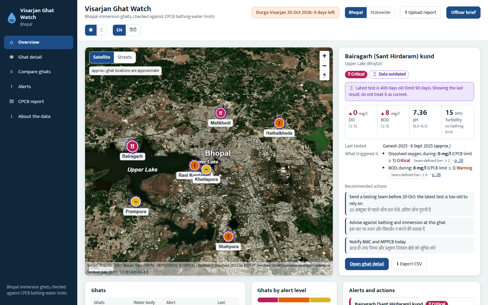

# Visarjan Ghat Watch

Track: 2 Visarjan Ghat Watch
Team: [TEAM NAME] · [member 1], [member 2], [member 3], [member 4], [member 5]

## The user
The Bhopal Municipal Corporation officer who plans Durga visarjan at the ghats. They use it in the days before 20 October 2026 to decide where to send aeration, cleaning and water-testing teams.

## What it does
It turns three years of MPPCB immersion water tests (1,524 readings, 7 Bhopal ghats, 2023–25) into a **rules-based alert** for every ghat: Critical, Warning, Advisory or Meets bathing limits. Each alert lists which readings set it off, by how much, against which CPCB limit, and on which report page, along with recommended actions in English and Hindi. A ghat whose latest test is older than 90 days also shows **"Data outdated"**, never "safe".

The dashboard has:
- a satellite and 3D terrain map
- a per-ghat view with trend charts that draw the limit line
- a cross-ghat comparison
- the CPCB report
- CSV exports
- an officer brief to copy into WhatsApp or print

Every screen works in Hindi or English and in light or dark mode. Next year, BMC uploads the new MPPCB report PDF in the browser and everything updates; no developer is needed.

## Demo
[Link to the 2-minute recording]

## How to run it (4 steps)
1. Install Python 3 (any recent version). Nothing else is needed to *use* the tool.
2. `git clone <this repo>` and `cd visarjan-ghat-watch`
3. `python -m http.server 8765`
4. Open http://localhost:8765/site/ for the landing page, or http://localhost:8765/site/app.html for the dashboard.

**Uploading a PDF needs step 3**, because browsers block the PDF reader on `file://`.

To rehearse the yearly update, open http://localhost:8765/site/app.html?until=2024, which hides 2025. Click **Upload report** and drop `resources/Ganesh_and_Durga_visarjan_report-2025.pdf`.

**Optional sharper satellite imagery:** copy `.env.example` to `.env`, set `MAPTILER_KEY`, and run `python pipeline/build_data.py`. This writes the gitignored `site/data/env.js`. A key used in a browser is visible to visitors, so restrict it to your domain in MapTiler.

**For developers:**
- `npm install`, then `npm test` (alert engine, scoring and PDF-parser tests) and `npm run e2e` (upload flow in Chrome; needs the step 3 server running).
- `node tests/screens.js` takes screenshots of every view in both themes, both languages, and desktop and mobile widths.
- After editing anything in `data/`, run `python pipeline/build_data.py`.
- There is no build step and no framework: plain HTML, CSS and JavaScript.

## What's on screen
- **Landing page (`site/index.html`):** a slow satellite and terrain flyover across the 7 ghats, with a live list of each ghat's latest alert.
  - The map library loads only after the page has appeared, and not at all with data saver on or on 2G.
  - If the system asks for reduced motion, the flyover doesn't run, and there is always a pause button.
- **Overview:**
  - **Map:** satellite by default, with a switch to streets and 3D terrain. Pins are coloured by alert level and always carry an icon and a label: **!!** critical, **!** warning, **~** advisory, **✓** meets limits, **?** no data. A dashed violet ring means the data is outdated.
  - **Ghat panel:** latest DO, BOD, pH and turbidity against their limits, what triggered the alert, and the actions.
  - Below the map: the site table, the count of ghats at each alert level, and the alert list.
- **Ghat detail:**
  - the alert, its triggers with page links, and the actions in both languages
  - the pattern across all seasons
  - DO, BOD and pH **trend charts** with the CPCB limit drawn in, untested points marked ✕ and breaches as ◆, each with a table view
  - all 13 parameters for every season, with links to the report pages and CSV export
- **Compare ghats:** for one parameter and season, a dot chart of before, during and a week after for every ghat, sorted worst first, with the limit line and "not tested" marked. A table view is also available.
- **Alerts:** a full alert card for every ghat.
- **CPCB report:** breaches out of readings actually tested, overall and per ghat.
- **About the data:** what the data doesn't tell you, the alert rules table, and sources and credits.
- **Officer brief:** English, हिंदी or both, with **Copy for WhatsApp** and **Print / Save as PDF**.
- **Upload report:** drop an MPPCB PDF or a CSV.
  1. The browser reads every table and matches the 7 ghats.
  2. A review screen shows what was found and what is missing, plus any unrecognised Bhopal site names for you to map or skip.
  3. You confirm, and everything updates.
- **Statewide:** a button marks where coverage of about 100 MP sites will go in v2.

## How the alerts work
The thresholds are all in `site/js/config.js` (`alerts`). They are based on the CPCB Primary Water Quality Criteria, Class B (organised outdoor bathing):

| Parameter | Advisory | Warning | Critical |
|---|---|---|---|
| Dissolved oxygen | below 5 (CPCB B) | below 4 (CPCB C/D) | below 2 *(team-defined)* |
| BOD | above 3 (CPCB B) | above 6 *(team-defined, 2× limit)* | above 12 *(team-defined, 4× limit)* |
| pH | outside 6.5–8.5 (CPCB B) | outside 6–9 (CPCB C) | – |
| Faecal coliform | above 500 (CPCB B) | above 2,500 | – (not in the reports) |

- **Team-defined tiers:** CPCB sets no tiers above its class limits. The tiers marked *team-defined* are our judgement and are labelled that way in the app.
- **Not used for alerts:** COD, solids, turbidity, conductivity and metals have no bathing limit. They are shown, but never used for alerts.
- **Which data counts:** the engine uses each ghat's latest tested season. The worst rule broken sets the level.
- **Missing data:** a missing DO, BOD or pH adds a testing action. BDL counts as tested and low.
- **Dates:** the reports print no sampling dates, so dates are taken from the festival day and marked *approx.*
- **Outdated data:** data older than `staleDays` (90) is shown as **Data outdated** next to the last result.
- **Tests:** `site/js/alerts.test.js` covers every level, the boundary values, missing parameters and stale data.

The **ranking and pattern** (weighted breaches across all seasons) is described in [docs/methodology.md](docs/methodology.md). It reproduces the problem statement's figures exactly: 42 of 116 DO readings below 5, and 100 of 112 BOD readings above 3. The product spec is in [docs/PRD.md](docs/PRD.md).

## Design decisions
- **Map tiles:**
  - Satellite: **EOX Sentinel-2 cloudless 2023**. It needs no key; its licence (CC BY-NC-SA 4.0) allows non-commercial public use; resolution is 10 m.
  - Terrain: **AWS Terrain Tiles** (Terrarium encoding), as `raster-dem-source` with terrain `{"source": "raster-dem-source", "exaggeration": 0.5}`.
  - Streets: OpenFreeMap.
  - Every source is credited on the map and in About.
  - Terrain is re-added after every style change.
- **Hindi on the map:** MapLibre draws text from pre-made glyphs and does not join Devanagari letters properly. `tests/devanagari.html` shows "प्रदेश" and "क्षिप्रा" breaking. So ghat names and key places (भोपाल, बड़ा तालाब, छोटा तालाब) are **HTML labels**, which the browser renders correctly. Street-map labels switch with `setLayoutProperty` but stay in English in Hindi mode. The trade-off is that only the places we label get Hindi names on the map. `HINDI_GLYPHS` in `basemap.js` turns Hindi street labels back on once MapLibre supports this.
- **Text:** every ghat name, alert, action and UI label is in `site/js/i18n.js`. The choice of language is remembered.
- **Fonts:** **Mukta** (SIL OFL), self-hosted. Its Devanagari files load only when Hindi text is on screen.
- **Themes:** colour variables in `style.css`. The page follows the system setting on first visit, remembers the choice, and sets the theme before the first paint, so there is no flash. Alert colours were checked with a palette validator and for WCAG AA contrast in both themes. Colour is never the only signal: every status also has an icon and a label.
- **Charts:** hand-written SVG with no chart library. Each chart type answers one question: a line for trends, a dot chart for comparing ghats, counts and a stacked bar for status (no donut), and tables for compliance. Every chart has a table view.

## What works
- Alerts, actions, trends, comparison, report and brief for all 7 ghats, with every number linked to its MPPCB report page.
- In-browser PDF parsing: on the 2023, 2024 and 2025 reports it reproduces all 1,524 checked rows (`site/js/pdfparse.test.js`).
- CSV upload with validation, CSV exports with source pages, limits and approximate sampling dates.
- Both themes and both languages on every screen, from 390 px phones up to desktop; 24 unit tests and the end-to-end test pass.

## What doesn't (yet), and what the data can't tell you
- **Every ghat currently shows "Data outdated":** nothing has been tested in the last 90 days. The newest data is Durga 2025, about October 2025.
- **Ghat locations are approximate** ([docs/verification-log.md](docs/verification-log.md)).
- **No coliform data** in the reports, though Class B sets a coliform limit. Only 4 metals were tested.
- The reports print **no units and no sampling dates**. Units are assumed, and dates are approximated from the festival.
- **Bairagarh and Malikhedi have no Durga 2025 table.**
- "Rani Kamlapati ghat / Kamla Park kund" may be **two places**.
- These are **past readings, not a forecast**. **No health effects are claimed.**
- **Images in the PDFs:** a scanned (image-only) PDF can't be parsed, so use CSV upload for those reports.
- **Satellite detail:** at 10 m, small kunds look blurry. A MapTiler key gives sharper imagery.
- **Hindi on the street map** stays English (see Design decisions). The Hindi text should be checked by a native-speaking officer.
- **Statewide coverage** is planned for v2. The statewide data in the pack is less checked and has no coordinates.

## Data used
All from the organisers' data pack (https://github.com/Laaaaksh/bhopal-impact-lab-2026, `tracks/02-visarjan-ghat-watch`):
- `data/bhopal_ghats_2023_2025.csv`: MPPCB immersion readings for the 7 Bhopal ghats.
- `data/cpcb_water_quality_criteria.csv`: CPCB water-quality criteria (https://cpcb.gov.in/water-quality-criteria/).
- `resources/`: the original MPPCB reports, so source links work offline:
  - 2025: https://www.mppcb.mp.gov.in/proc/mon/Ganesh_and_Durga_visarjan_report-2025.pdf
  - 2024: https://www.mppcb.mp.gov.in/proc/mon/Ganesh_and_Durga_visarjan_report-2024.pdf
  - 2023: https://www.mppcb.mp.gov.in/proc/mon/Idol_immer._Report_23_CPCB.pdf

Extra data and services:
- `data/ghats.geojson`: approximate ghat coordinates placed by the team (to be verified).
- `site/img/ghats/`: ghat photos and water-test table images cut from the MPPCB reports above.
- Satellite: Sentinel-2 cloudless 2023 by EOX IT Services GmbH (https://s2maps.eu), contains modified Copernicus Sentinel data, CC BY-NC-SA 4.0.
- Terrain: AWS Terrain Tiles / Mapzen (https://github.com/tilezen/joerd/blob/master/docs/attribution.md).
- Streets: © OpenStreetMap contributors, via OpenFreeMap (https://openfreemap.org).

Libraries and fonts, all included in the repo: MapLibre GL JS (BSD-3-Clause), pdf.js (Apache-2.0), Mukta by Ek Type (SIL OFL 1.1).

## Licence
MIT. See [LICENSE](LICENSE). No API keys or secrets are in the code; the optional MapTiler key goes in `.env`, which is gitignored.
